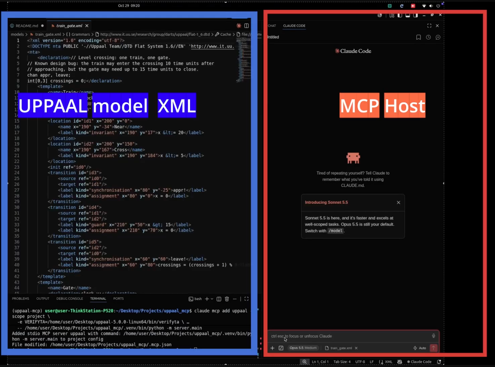

# uppaal-mcp

An [MCP](https://modelcontextprotocol.io) server that lets an AI agent (Claude Code, Claude Desktop or any MCP client) model-check [UPPAAL](https://uppaal.org) timed-automata models with `verifyta`.

You state a requirement in plain language. The agent then:

1. writes the UPPAAL query,
2. asks you to confirm it,
3. runs `verifyta`,
4. explains any counterexample step by step,
5. proposes a minimal model fix.

The server applies a fix only after you approve it, and commits each fix to git.

**Verdicts always come from `verifyta`.** The server never infers a result. A property is reported as holding only when `verifyta` printed `Formula is satisfied`. Timeouts, inconclusive results and errors are reported as unknown.

## What it looks like

[](https://youtu.be/4Jb_So3kxsI)

**▶ Click the thumbnail above to watch the demo video on YouTube.**



```
You:    Check that the gate is always down while the train is in the crossing.

Agent:  → read_model("train_gate")
        → propose_query(..., uppaal_queries=["A[] (train.Cross imply gate.Down)",
                                             "E<> train.Cross"])
        I'd formalize this as:
          1. A[] (train.Cross imply gate.Down): in every reachable state where the
             train is in Cross, the gate is Down.
          2. E<> train.Cross: sanity check that the train can reach Cross at all,
             so (1) can't hold vacuously.
        OK to verify?
You:    yes
Agent:  → verify("train_gate", query_file="queries/candidates/train_gate.q")
        Query 1 is VIOLATED. → get_trace(...)
        Step 3: the train enters Cross at t=10 while the gate is still Lowering,
        because the gate can take up to 15 time units to close…
```

## Requirements

- **Linux or macOS.** The server uses POSIX process groups and `setrlimit` to enforce time and memory limits, so Windows is not supported (WSL works).
- **Python ≥ 3.10** and [uv](https://docs.astral.sh/uv/) (recommended), or plain `pip`.
- **UPPAAL 5.x** with its command-line verifier `verifyta`. Download it from [uppaal.org](https://uppaal.org/downloads/). UPPAAL needs a license, which is free for academic and non-commercial use. Activate it once according to the UPPAAL instructions before using this server. The server was developed and tested against UPPAAL 5.0.0.
- **git**. `patch_model` commits every model change, so the workspace must be a git repository.

Check that `verifyta` works on its own first:

```bash
/path/to/uppaal-5.0.0-linux64/bin/verifyta --version
```

## Installation

```bash
git clone https://github.com/<your-org>/uppaal-mcp.git
cd uppaal-mcp
uv sync
```

Without uv:

```bash
python -m venv .venv && source .venv/bin/activate
pip install -e .
```

This installs the `uppaal-mcp` command, a stdio MCP server.

## Configuration

The server reads three environment variables:

| Variable | Required | Meaning |
|---|---|---|
| `VERIFYTA` | **yes** | Absolute path to the `verifyta` binary. |
| `UPPAAL_WORKSPACE` | no | Directory with your `models/` and `queries/`. Defaults to the repository root. |
| `UPPAAL_MEMORY_MB` | no | Memory limit for each `verifyta` run, in MB (default `4096`). |

### Claude Code

From the repository root:

```bash
claude mcp add uppaal \
  --env VERIFYTA=/path/to/uppaal-5.0.0-linux64/bin/verifyta \
  --env UPPAAL_WORKSPACE="$PWD" \
  -- uv --directory "$PWD" run uppaal-mcp
```

To share the configuration with your project instead, create a `.mcp.json` in the workspace:

```json
{
  "mcpServers": {
    "uppaal": {
      "type": "stdio",
      "command": "uv",
      "args": ["--directory", "/absolute/path/to/uppaal-mcp", "run", "uppaal-mcp"],
      "env": {
        "VERIFYTA": "/absolute/path/to/uppaal-5.0.0-linux64/bin/verifyta",
        "UPPAAL_WORKSPACE": "/absolute/path/to/your/workspace"
      }
    }
  }
}
```

Run `/mcp` inside Claude Code to check that the `uppaal` server is connected.

### Claude Desktop and other MCP clients

Add the same `command`, `args` and `env` to the client's MCP configuration. For Claude Desktop, that is `claude_desktop_config.json` under `"mcpServers"`. Any client that supports stdio servers will work.

## Workspace layout

```
<workspace>/
├── models/                 UPPAAL models (*.xml); the agent may patch these
├── queries/
│   ├── <model>.q           CONFIRMED requirements; read-only for the agent
│   └── candidates/         queries the agent proposes, waiting for your confirmation
├── traces/<run_id>/        output and traces of every verify run (git-ignored)
└── runs.jsonl              log of every run: options, verdicts, model git commit (git-ignored)
```

The confirmed requirements for `models/foo.xml` are in `queries/foo.q`. Each query is preceded by a comment that states the requirement in plain language:

```
/* REQ: R2: whenever the train is in the crossing, the gate is down. */
A[] (train.Cross imply gate.Down)
```

To use your own models, either drop them into `models/` here, or point `UPPAAL_WORKSPACE` at a git repository that has its own `models/` and `queries/` folders.

The repository includes an example model, [`models/train_gate.xml`](models/train_gate.xml), with two confirmed requirements. [`models/README.md`](models/README.md) describes it.

## Human in the loop

The agent can read everything, but its writes are restricted:

| Action | Who | How |
|---|---|---|
| Propose a query | agent | `propose_query` writes only into `queries/candidates/` |
| **Confirm a requirement** | **you** | move the query from `queries/candidates/<model>.q` into `queries/<model>.q` |
| Change a model | agent, after you approve | `patch_model(dry_run=true)` shows the diff; the real call syntax-checks the model and commits it |

No tool can write to `queries/<model>.q`, so the agent can't make a failing requirement pass by weakening it. All file paths are resolved inside the workspace, and paths outside it are rejected.

## Tools, resources and prompt

**Tools**

| Tool | Purpose |
|---|---|
| `list_models` | Models in the workspace, with their templates, query files and git state. |
| `read_model` | Structure of a model as JSON: declarations, templates, locations, edges. |
| `check_syntax` | Compile a model and type-check queries, without verifying. |
| `verify` | Run `verifyta`. Returns one verdict per query: `satisfied`, `violated`, `maybe`, `timeout` or `error`. |
| `get_trace` | The counterexample or witness of one query, summarized and pageable. |
| `propose_query` | Type-check the agent's queries and save them as candidates with their requirement text. |
| `patch_model` | Make targeted edits to a model, syntax-check it, show the diff, and git-commit it. Warns when an edit may remove behaviour. |

**Resources**

| URI | Content |
|---|---|
| `uppaal://requirements` | JSON index of all confirmed requirements and their queries. |
| `uppaal://requirements/{model}` | The raw confirmed requirements file of one model. |
| `uppaal://docs/query-language` | Cheat sheet for the UPPAAL query language, including common pitfalls such as vacuous implications. |

**Prompt**

`verify_requirement(requirement, model)` runs the full loop: formalize, confirm, verify, explain the trace, diagnose (design bug, modeling error or mis-formalized requirement), fix, and re-verify all confirmed requirements. In Claude Code, run it as `/mcp__uppaal__verify_requirement`.

## Verdicts

| Verdict | Meaning |
|---|---|
| `satisfied` | `verifyta` proved the property. |
| `violated` | `verifyta` disproved it. Call `get_trace` for the counterexample. |
| `maybe` | Inconclusive (approximate analysis). **Unknown.** |
| `timeout` | Not decided within `timeout_s` (default 60 s, max 600 s). **Unknown.** |
| `error` | Compile error, runtime error or memory limit. **Unknown.** |

## Development

```bash
uv run pytest
```

Most tests run against `verifyta` output captured in `tests/fixtures/`, so they don't need UPPAAL. Tests marked `live` run the real binary and are skipped unless `VERIFYTA` points to it:

```bash
VERIFYTA=/path/to/verifyta uv run pytest
```

Run the server by hand (it talks MCP over stdin/stdout):

```bash
VERIFYTA=/path/to/verifyta uv run uppaal-mcp
```

You can inspect it interactively with the [MCP Inspector](https://github.com/modelcontextprotocol/inspector):

```bash
npx @modelcontextprotocol/inspector uv run uppaal-mcp
```

## Limitations

- Only symbolic queries are supported: `A[]`, `E<>`, `A<>`, `E[]` and `-->`. Statistical model checking (`Pr[...]`, `simulate`) is not.
- Linux and macOS only.
- `verifyta` itself is not included. You need your own UPPAAL installation and license.

## License

<!-- TODO: choose a license (e.g. MIT or Apache-2.0) and add a LICENSE file. -->

UPPAAL is developed by Uppsala University and Aalborg University and is distributed under its own license. This project is not affiliated with the UPPAAL team.
